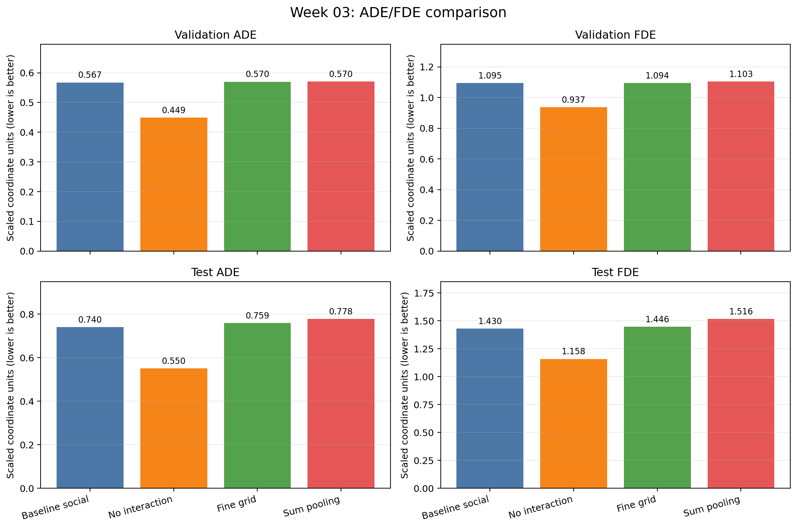
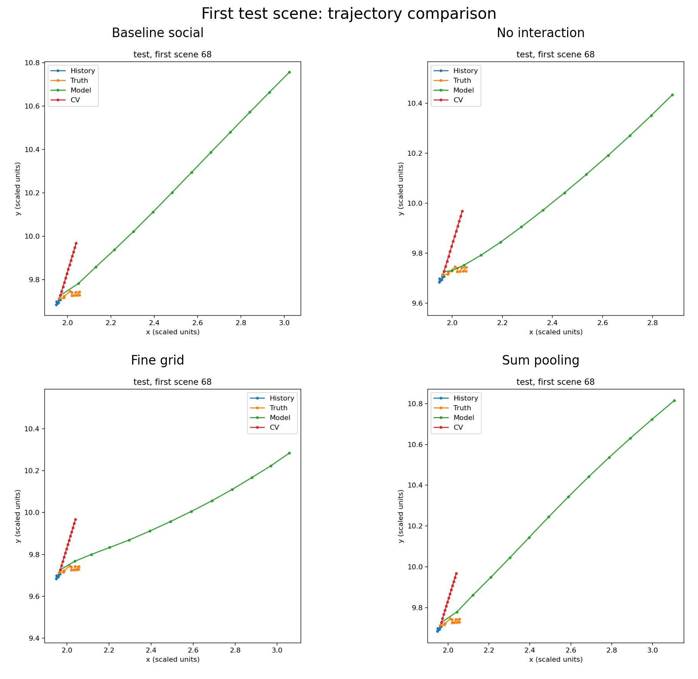

# week03：TrajNet++ 邻域与池化实验

本周使用 TrajNet++ 的 LSTM baseline，在同一份圆形对穿课堂数据上研究三个问题：

1. **无交互基线**：去掉邻居信息后，预测是否变好；
2. **网格分辨率**：保持 4 个坐标单位的观察范围不变，把 `4×4` 网格细化为 `8×8`；
3. **池化规则**：同格多个邻居由原来的重复索引赋值改成逐维求和。

所有主对比模型都训练 10 轮，使用相同的数据划分、8 帧历史、12 帧预测、随机种子 42 和 CPU
评价协议。最终结果中，**无交互模型的 ADE/FDE 最低**；细化网格和同格求和都没有改善默认
social baseline。这个结论只针对当前课堂小样本和训练配置，不能推广成“邻居信息没有用”。

---

# 一、实验设计

## 1.1 数据与评价口径

数据来自 `circle_classroom`：训练、验证、测试分别有 56、12、12 个场景。每个样本使用前 8
个采样点作为历史，递推预测后 12 个采样点。评价只计算每个场景的主要目标行人，但模型在
预测时保留全部 64 名行人作为潜在邻居，不传入任何真实未来轨迹。

- **ADE**：12 个预测点与真实轨迹之间距离的平均值；
- **FDE**：最后一个预测点与真实终点之间的距离；
- 两个指标都是越小越好；
- 这里报告的是换算后的坐标单位。厘米到米的换算假设尚未由元数据确认，因此不直接写成米。

数据按时间先划分再截取窗口，三个集合没有共享帧。不过样本来自一次实验，部分窗口重叠，
而且测试段运动更平稳，所以结果不能代表新场景泛化能力。

## 1.2 共同 baseline

默认模型为 `social` LSTM。每名邻居的历史运动经过自己的 LSTM 得到隐藏状态，再从 32 维
压缩到 8 维；邻居相对位置决定这 8 维特征放入哪个网格。默认网格是 `n=4`、
`cell_side=1`，即 `4×4` 个格子，总边长为 4 个坐标单位。网格展开后编码成 32 维交互向量，
与目标行人自己的 16 维运动嵌入一起输入 LSTM。

共同配置：

```text
epochs=10, batch_size=2, hidden_dim=32
coordinate_embedding_dim=16, pool_dim=32, latent_dim=8
obs_length=8, pred_length=12, seed=42, CPU threads=2
```

## 1.3 三个修改方向

| 实验 | 修改 | 研究问题 | 参数量 |
|---|---|---|---:|
| Baseline social | `type=social, n=4, cell_side=1` | 默认参照 | 25,777 |
| 无交互 | `type=vanilla` | 不使用邻居是否更好 | 13,193 |
| 细网格 | `n=8, cell_side=0.5` | 总范围不变，空间划分更细是否有帮助 | 38,065 |
| 求和池化 | 同格邻居特征用 `scatter_add` 求和 | 保留同格所有邻居是否优于覆盖 | 25,777 |

细网格把每边格子数扩大 2 倍，因此格子总数由 16 增加到 64，即默认的 4 倍。它保持总边长
`n × cell_side = 4` 不变，但网格编码层输入维度随之增加，所以参数量也增加了约 47.7%。

求和池化保留 baseline 的结构和参数量，只改变同格多人时的聚合规则。对同一格中的隐藏特征
`h₁, h₂, …, hₖ`，新规则为：

```text
grid[cell] = h₁ + h₂ + … + hₖ
```

原实现使用重复索引直接赋值，同格多人不能解释为标准求和或平均，并可能丢失部分邻居信息。
求和实现位于 [`sum_gridbased_pooling.py`](model/trajnetbaselines/lstm/sum_gridbased_pooling.py)。

---

# 二、代码与目录

```text
week03/
├── README.md
├── model/
│   ├── run_classroom.py                  默认、无交互和细网格训练入口
│   ├── run_classroom_sum_pooling.py      求和池化训练入口
│   ├── evaluate_classroom.py             统一 ADE/FDE 与轨迹评价
│   ├── make_comparison_figures.py        汇总指标并生成本 README 的对比图
│   ├── requirements-classroom.txt
│   └── trajnetbaselines/lstm/
│       ├── gridbased_pooling.py           上游默认网格池化，用于对照
│       └── sum_gridbased_pooling.py       同格逐维求和实现
└── results/
    ├── checkpoints/                      四个最终模型，不含逐轮中间 checkpoint
    ├── metrics/                          配置、val/test JSON 与 summary.csv
    └── figures/                          单模型轨迹图及综合对比图
```

`model/` 保存本次实验直接相关的代码快照；完整 TrajNet++ 依赖仍由仓库根目录提供。
`results/checkpoints/` 中只保留最终模型，避免将 `.epoch0` 到 `.epoch10` 的重复文件放进提交目录。

主要运行命令：

```powershell
# social baseline
.\.venv\Scripts\python.exe run_classroom.py --output baseline

# 方向一：无交互
.\.venv\Scripts\python.exe run_classroom.py --type vanilla --output no_neighbours

# 方向二：总范围不变，网格细化为 8×8
.\.venv\Scripts\python.exe run_classroom.py --n 8 --cell_side 0.5 --output 4TimeResolution

# 方向三：同格求和
.\.venv\Scripts\python.exe run_classroom_sum_pooling.py --output sum_pooling_baseline

# 统一评价，以 baseline 的测试集为例
.\.venv\Scripts\python.exe evaluate_classroom.py `
  OUTPUT_BLOCK/circle_classroom/lstm_social_baseline.pkl --split test

# 从保存的 JSON/PNG 重建汇总表和对比图
.\.venv\Scripts\python.exe week03/model/make_comparison_figures.py
```

---

# 三、结果

## 3.1 ADE/FDE

| 模型 | Val ADE | Val FDE | Test ADE | Test FDE | 训练时间 (s) |
|---|---:|---:|---:|---:|---:|
| Baseline social | 0.5672 | 1.0947 | 0.7401 | 1.4295 | 69.59 |
| **无交互 vanilla** | **0.4489** | **0.9369** | **0.5498** | **1.1583** | 40.98 |
| 细网格 `8×8` | 0.5698 | 1.0944 | 0.7586 | 1.4461 | 104.11 |
| 同格求和 | 0.5701 | 1.1034 | 0.7776 | 1.5162 | 96.16 |



相对 social baseline，测试集结果为：

- 无交互：ADE 下降约 **25.7%**，FDE 下降约 **19.0%**；
- 细网格：ADE 上升约 **2.5%**，FDE 上升约 **1.2%**；
- 同格求和：ADE 上升约 **5.1%**，FDE 上升约 **6.1%**。

## 3.2 轨迹对比

下图统一使用测试集第一条场景 68。蓝色是 8 帧历史，橙色是真实未来，绿色是模型预测，红色是
匀速外推（CV）。四个子图的坐标轴会根据各自预测范围自动缩放，因此应看轨迹的方向、曲率和
终点偏差，不能只按线段在图上的视觉长度比较。



四个模型都把未来运动幅度预测得过大，绿色轨迹明显越过真实橙色轨迹。三个 social 模型的预测
尤其长，并逐渐向右上方偏离。无交互模型仍然过冲，但整体误差较小，这与 12 个测试场景上的
ADE/FDE 排名一致。细网格改变了预测曲率，却没有把终点拉回真实区域；求和池化让这一场景中的
预测幅度进一步增大。

这张图只展示一个固定场景，用于解释模型怎样出错；模型总体优劣仍以全部 12 个场景的
ADE/FDE 为准。四个模型都明显落后于匀速外推：测试集 CV 的 ADE 为 0.1251、FDE 为 0.2339。
这说明当前测试时间段运动较平稳，而小样本 LSTM 尚未学到比短期速度延续更可靠的规律。

## 3.3 三个方向分别说明了什么

### 方向一：无交互基线

无交互模型是本轮表现最好的神经网络，同时参数量减少约 48.8%，训练时间也最短。这说明当前
social 网格中的邻居表示没有带来有效增益，反而可能增加了拟合难度。可能原因包括：训练场景少、
测试段较平稳、64 名邻居带来较多无关信息，以及网格特征没有充分区分真正影响目标行人的邻居。

但这个比较同时移除了交互模块并减少参数量，所以不能单独证明“邻居信息有害”。更严格的验证
应保留同样网络结构，只把邻居输入置零后重新训练，从而排除参数量和结构差异。

### 方向二：网格分辨率

把 `4×4` 细化成 `8×8` 后，观察范围不变，验证集结果几乎没有变化，测试集略差。更细的格子
虽然能更精确地区分邻居位置，却把网格编码层参数量从 baseline 的 25,777 增加到 38,065，并使
输入更加稀疏。在仅 56 个训练场景的条件下，额外空间细节没有转化为更好的泛化。

本实验只比较了两个分辨率，不能据此找到最佳 `n`。若继续研究，应加入 `2×2` 或其他中间配置，
并报告多个随机种子，区分稳定趋势与单次训练波动。

### 方向三：池化规则

同格求和修复了默认重复索引赋值可能覆盖邻居的问题，而且没有改变模型参数量，因此它是比细网格
更干净的机制对照。但求和使格子特征的幅值随同格人数增大，把“邻居运动特征”和“局部人数”混在
一起；当前结果比 baseline 略差，说明这种密度增强在本配置下没有被模型有效利用。

下一步可对比同格平均和逐维最大值。平均池化能保留平均运动模式并控制特征尺度；最大池化可以
保留每个维度上的强响应。还可以单独输入同格人数，让模型自行学习密度权重，而不是让人数直接
放大所有隐藏特征。

## 3.4 总体发现

本轮最可靠的结论是：在固定 10 轮和当前数据划分下，增加 social 网格复杂度没有降低误差，
简单的 vanilla LSTM 反而更好。细网格和求和池化都属于合理修改，但“信息更多、划分更细”并不
自动意味着预测更准。模型需要足够数据学会忽略无关邻居，同时聚合特征的数值尺度也必须稳定。

所有 LSTM 结果都弱于匀速外推，说明现在更需要先检查数据阶段差异、增加训练数据或重复实验，
而不是根据这一次结果继续堆叠交互模块。测试集已经用于最终汇报，后续结构选择应回到验证集，
不要继续根据这 12 个测试场景调整模型。

---

# 四、AI 在流程中的作用

本实验中，AI 主要承担了代码阅读、实现辅助、运行检查和文档整理：

- 解释 `run_classroom.py` 的参数及 `social` 网格池化的数据流；
- 运行求和版本的 10 轮训练以及 val/test 评价，检查保存模型在新进程中仍加载求和池化类；
- 读取已有模型的配置和指标，整理目录、生成 ADE/FDE 柱状图与四模型轨迹对比图，并起草本说明。

三个研究方向、实验范围以及最终采用哪些结果由使用者决定。README 中的数值直接来自保存的
JSON，不是 AI 生成的模拟数据。AI 给出的代码和解释仍需要人工核对；本轮已通过语法检查、构造
样例、模型重新加载和统一评价进行验证。

---

# 五、文件索引与限制

- 汇总数据：[`summary.csv`](results/metrics/summary.csv)
- Baseline 模型：[`baseline_social.pkl`](results/checkpoints/baseline_social.pkl)
- 无交互模型：[`no_interaction_vanilla.pkl`](results/checkpoints/no_interaction_vanilla.pkl)
- 细网格模型：[`fine_grid_n8_cell0.5.pkl`](results/checkpoints/fine_grid_n8_cell0.5.pkl)
- 求和池化模型：[`sum_pooling.pkl`](results/checkpoints/sum_pooling.pkl)
- 每个实验的原始配置与 val/test JSON：[`results/metrics/`](results/metrics/)
- 每个实验的单独轨迹图与综合图：[`results/figures/`](results/figures/)

模型来源为 EPFL VITA 的 TrajNet++ baselines，固定上游提交
`99a6e9d8675face1aeeb17227b73dd3d1267f463`，代码采用 MIT 许可证。当前实验是 CPU 课堂小样本，
没有进行多随机种子统计、超参数搜索或论文规模复现；ADE/FDE 差异应结合这些限制解释。
