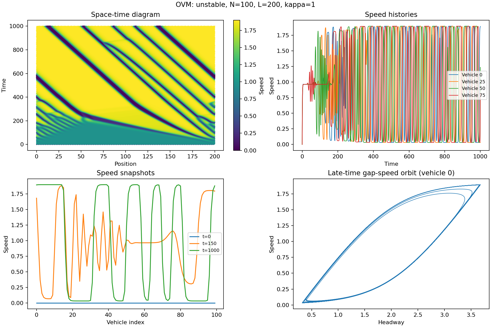
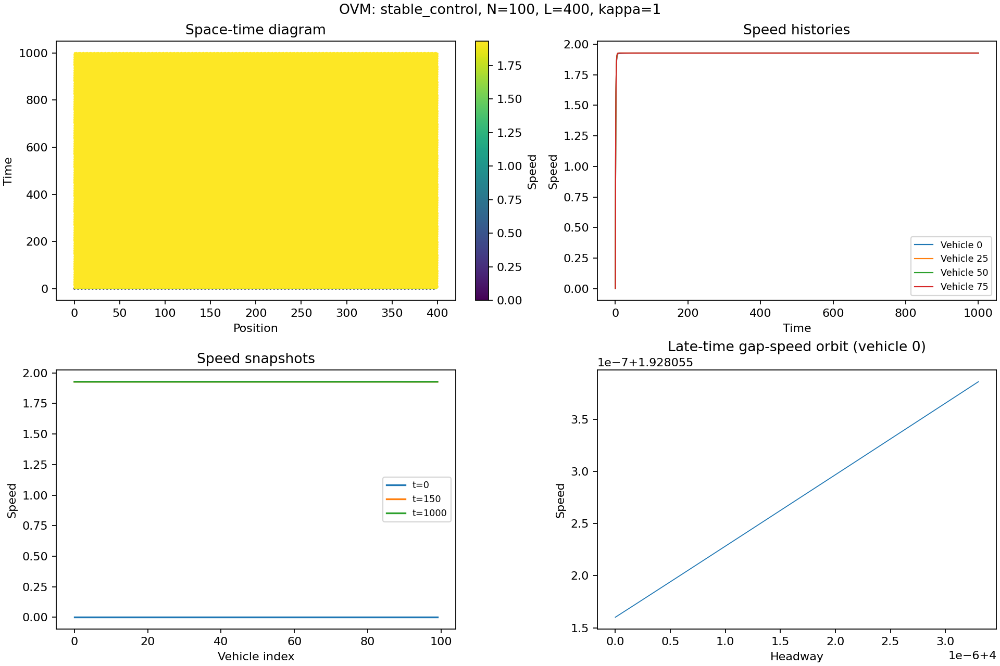
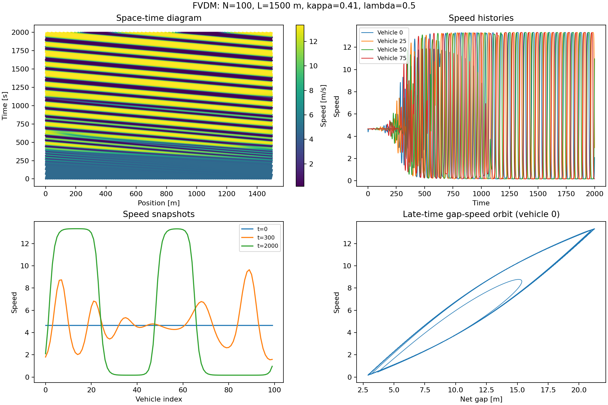
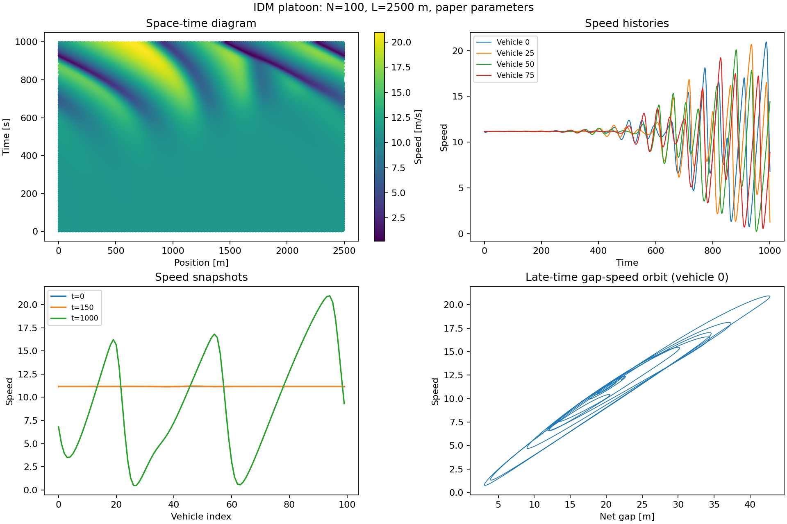

# 一、车队仿真

OVM、FVDM、IDM 均用于100辆车的环道车队。每辆车跟随前一辆车，最后一辆的前车为第0辆；所有车辆同步积分，观察小扰动如何发展成交通波。

从仓库根目录运行：

```powershell
python platoon_experiments/run_experiments.py
python platoon_experiments/run_experiments.py --model idm
```

依赖 NumPy、Matplotlib。默认步长0.05，四阶Runge-Kutta；用 `--dt` 调整，用 `--output` 指定结果目录。

## 场景

|模型|道路与时长|初始化|复现范围|
|---|---|---|---|
|OVM|L=200，另设L=400稳定对照；时长1000|等间距，第0辆前移0.1，全部初速为0|Bando的无量纲环道设置；稳定对照为增加的场景|
|FVDM|L=1500 m；时长2000 s|等间距，第0辆前移1 m，全部初速为V(15)|Jiang论文环道扰动设置|
|IDM|L=2500 m；时长1000 s|等间距，第0辆前移1 m，全部初速为均匀流平衡速度|论文参数加自设环道场景，观察车队扰动演化|

IDM环道实验是本次整理时补充的车队实验。早期的IDM双车结果和复现脚本已归入 `../two_vehicle_experiments/artificial/archive/early_idm/`，不再算作车队实验。

## 方程与参数

统一下标i+1为前车，`h=x_front-x`，`dv=v_front-v`。环道最后一辆的间距加上道路长度；积分使用展开位置，绘图时才取模。

- OVM：`a=kappa*(V(h)-v)`，`V(h)=tanh(h-2)+tanh(2)`，kappa=1；忽略车长，变量无量纲。均匀流稳定条件为 `V'(h0)<kappa/2`。L=200时不稳定，L=400时稳定。
- FVDM：`a=0.41*(V(h)-v)+lambda*dv`，`V(h)=6.75+7.91*tanh[0.13*(h-5)-1.57]`；h<=100 m时lambda=0.5，否则为0。车长5 m，净间距s=h-5，稳定阈值为 `0.41/2+0.5=0.705 /s`，V'(15)约0.957 /s。
- IDM：`a=0.73*[1-(v/v0)^4-(s_star/s)^2]`，`s_star=2+1.6*v-v*dv/(2*sqrt(0.73*1.67))`，v0=120/3.6 m/s，车长5 m。通过二分求解 `a(s=20,v,dv=0)=0` 得到初始平衡速度。

不截断速度、加速度或期望间距；检测到车辆重叠即报错。OVM/FVDM的环道设置及IDM参数分别依据 `../论文/` 中的三篇论文。IDM环道不是原论文高速公路实测拥堵场景的逐图复现。

## 结果

`results/` 下包含：

- `ovm_unstable.png`、`ovm_stable_control.png`、`fvdm.png`、`idm.png`：时空速度图、代表车辆速度历程、车队速度快照、后半段间距-速度轨迹。
- `summary_all.json`：全部模型的最小间距、速度范围、车队速度标准差、环道长度守恒误差；单模型运行产生 `summary_模型名.json`。
- `data/`：对应的NPZ时间序列。`x,v,h,s`形状为“时间点数×100辆车”，`t`为时间轴。平时只需看图和统计摘要。

OVM采用无量纲变量，其数值不能直接与有量纲FVDM、IDM混比。

## 图像结果

### OVM：扰动放大



### OVM：稳定对照



### FVDM



### IDM



`results/data/` 中的NPZ为本地生成文件，已被Git忽略；运行脚本可重新生成。图片与统计摘要保留在仓库中。
