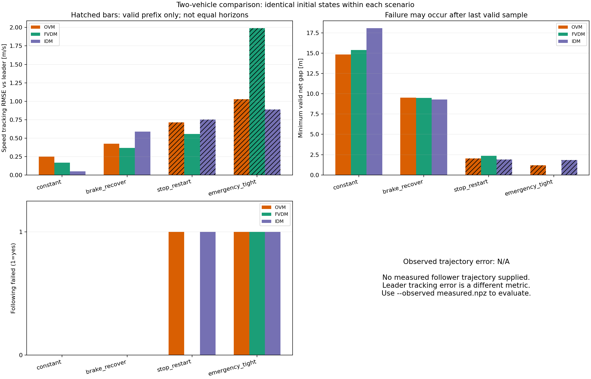
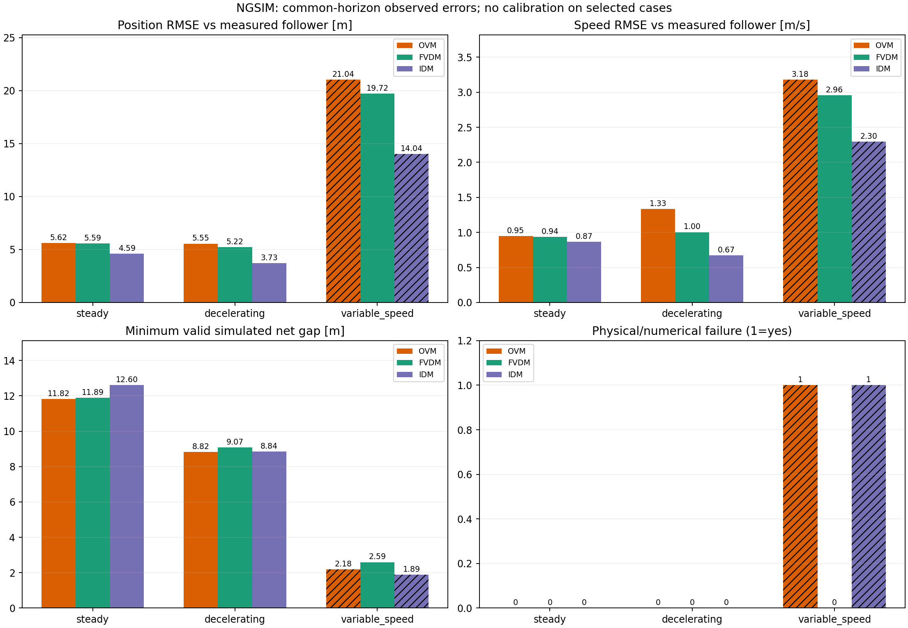

# 二、双车实验

仅后车使用跟驰模型，前车轨迹作为外部输入。包含地位平等的两类实验：

|类型|前车轨迹来源|入口|结果|
|---|---|---|---|
|[人工轨迹](artificial/README.md)|解析设定的匀速、减速、起步和急刹|`artificial/run_experiments.py`|`artificial/results/`|
|[NGSIM实测轨迹](ngsim/README.md)|真实前车位置重建|`ngsim/run_experiments.py`|`ngsim/results/`|

三个模型统一放在 `common.py`，两类实验共用相同公式、积分器、失败检测和绘图逻辑，避免模型实现不同造成比较偏差。

## 公式

统一 `dv=v_front-v`，净间距 `s=x_front-x-leader_length`。

- OVM：`a=kappa*(V(s)-v)`，kappa=0.85。
- FVDM：`a=kappa*(V(s)-v)+lambda*dv`，kappa=0.41；位置间距不超过100 m时lambda=0.5，否则为0。
- 二者使用有量纲 `V(s)=6.75+7.91*tanh(0.13*s-1.57)`，依据Jiang论文给出的标定形式；与车队实验里Bando无量纲OVM的参数不同。
- IDM：`a=0.73*[1-(v/v0)^4-(s_star/s)^2]`，`s_star=2+1.6*v-v*dv/(2*sqrt(0.73*1.67))`，v0=120/3.6 m/s。参数来自Treiber等论文表I。

## 共同指标

- 速度响应曲线、相对前车的速度RMSE及最大偏差、加速度范围。
- 最小净间距、最小TTC（仅在后车更快时计算）。
- 碰撞、负速度和数值异常；保留最后有效样本及首次检测到的失败时间。
- 真实后车位置、速度、净间距RMSE：NGSIM可计算，人工场景没有实测后车真值，标为N/A。

原公式不加速度裁剪、紧急制动或额外 `max(s_star, ...)`。净间距<=0、速度<-0.001 m/s或非有限状态时终止；图中的 **× 为最后有效点，不一定是碰撞点**。RK4中间阶段检测的事件时间为近似值，步长复核摘要保存在两类实验各自的 `results/validation.json`。

人工场景另把结束前10秒速度差MAE>0.5 m/s标为未恢复。实测前车结尾不一定匀速，NGSIM不使用该判据；另列 poor_fit（位置RMSE>10 m或速度RMSE>2 m/s），与物理失败区分。

NGSIM的三模型实测RMSE按共同有效时段计算，也保留各自时段的误差与覆盖率。人工总览中，提前终止的数据用斜线柱标识，不能因前缀RMSE较小而判定更好。

人工减速场景用速度中点越过时差描述响应；NGSIM用速度曲线在-5至5秒范围内的平移对齐描述响应。低波动时可为N/A；这些不是驾驶员反应时间的直接估计。

看结果打开PNG图和Markdown报告即可；JSON是详细统计；NPZ时间序列统一放入各自 `results/data/`。

## 人工前车轨迹结果

## NGSIM 实测轨迹结果

两类实验的完整轨迹图直接展示在各自README中。NPZ数组只在本地保存，由脚本生成，不纳入Git；图像、报告和JSON统计保留。
