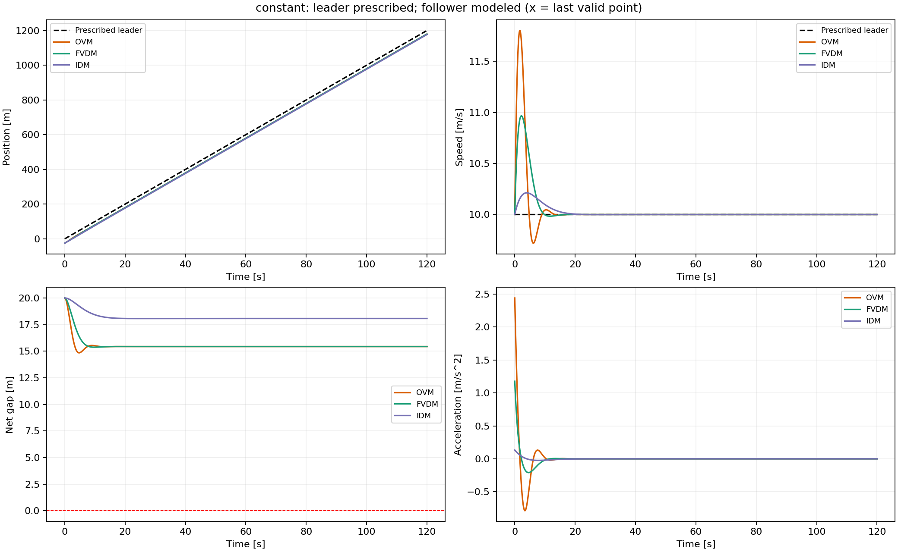
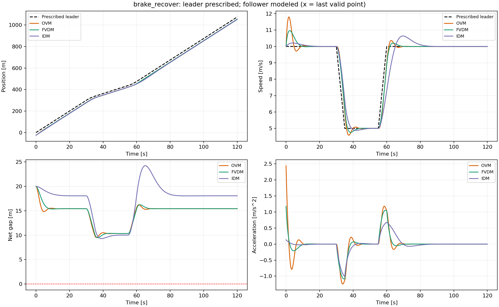
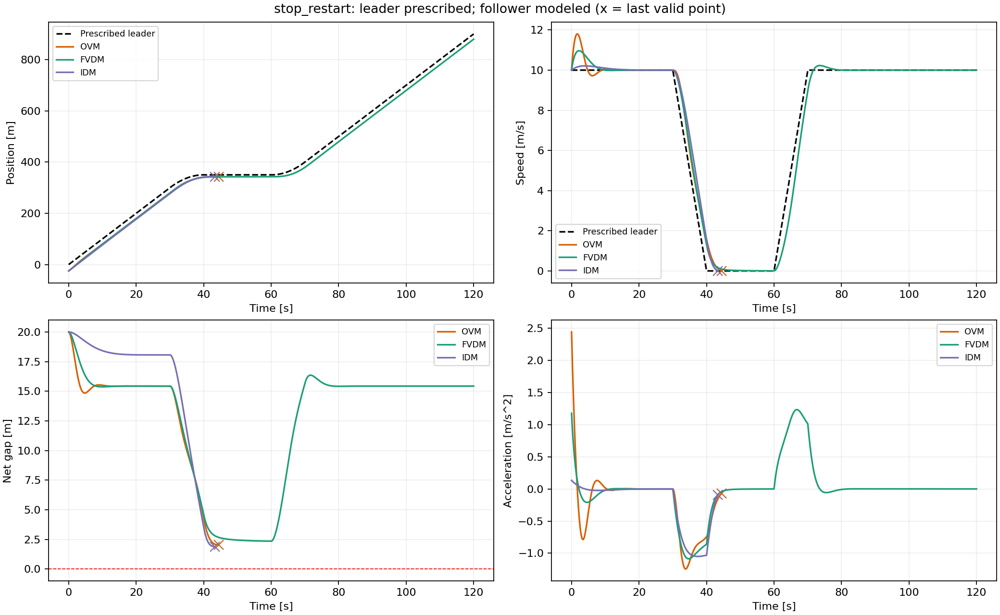
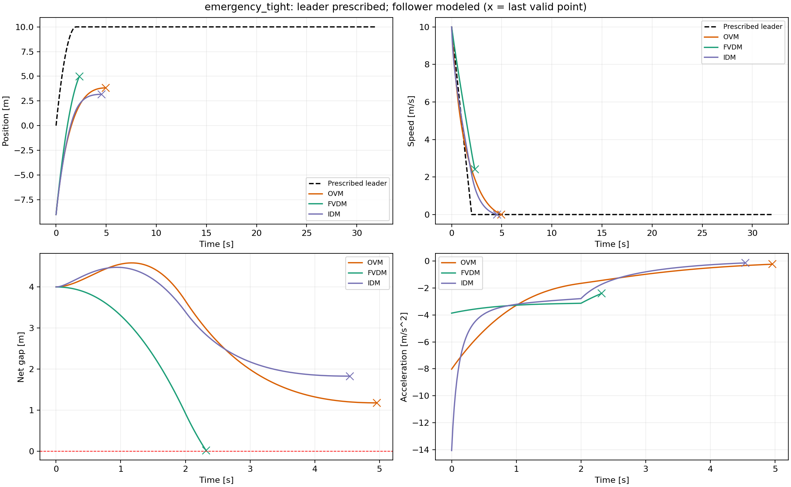

# 双车实验：人工设定前车轨迹

前车按解析公式运动，后车分别采用OVM、FVDM、IDM。每个场景三模型的初始位置与速度完全一致，不使用NGSIM数据。

从仓库根目录运行：

```powershell
python two_vehicle_experiments/artificial/run_experiments.py
```

默认步长0.02 s；支持 `--dt`、`--output`。依赖NumPy、Matplotlib。三个模型及公共逻辑见 `../common.py`。

|场景|前车运动|初始净间距|时长|
|---|---|---:|---:|
|constant|全程10 m/s匀速|20 m|120 s|
|brake_recover|先匀速30 s；以1 m/s²减速至5 m/s；保持20 s；以1 m/s²加速回10 m/s；继续匀速|20 m|120 s|
|stop_restart|先匀速30 s；以1 m/s²减速至0；停车20 s；以1 m/s²加速回10 m/s；继续匀速|20 m|120 s|
|emergency_tight|从10 m/s以5 m/s²减速至0，随后停车|4 m|32 s|

## 看结果

- 本页直接展示对比图和各场景轨迹，包含速度跟踪RMSE、最小净间距、失败情况。
- [指标报告](results/结果说明.md)：逐模型结果表与判据。
- `results/场景名.png`：位置、速度、净间距、加速度曲线。
- `results/metrics.json`：响应时差、完整参数、最小TTC、失败原因与时间等。
- `results/data/`：12份时间序列数组（4场景×3模型）。NPZ供代码读取，不是逐个查看的报告。
- `results/validation.json`：步长减半后的复核摘要。

人工场景没有实测后车真值，“真实轨迹误差”为N/A；与前车的速度差另列为跟踪指标。NGSIM是并列的另一类双车实验，提供实测误差。

`archive/early_idm/` 保留最早的20→5→20 m/s IDM双车实验、原结果和独立复现脚本；它是历史场景，不计入上述4场景比较，也不归入车队仿真。

## 总体比较


## 匀速前车



## 减速后恢复



## 停车后起步



## 短间距急刹



图中×为失败前最后有效点。`results/data/*.npz` 已加入Git忽略规则，本地保留，重新运行脚本可生成。
