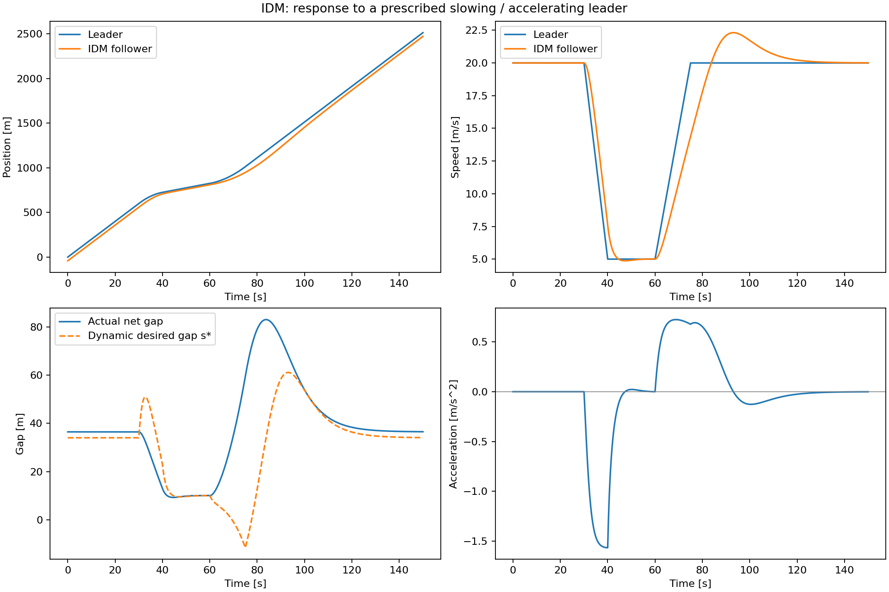

# 早期IDM双车实验存档

这是最早与OVM/FVDM环道代码混放的IDM双车场景，现归入双车实验的人工轨迹分支。前车速度20→5→20 m/s；后车使用论文IDM参数，初始为20 m/s平衡跟驰，运行150 s。

- `idm.png`、`idm.npz`、`metrics.json`：原正式结果。
- `summary_idm.json`：当时0.025 s步长的复核摘要。
- `validation_dt0025/`：相同步长的验证图和数组；`python_cache/`保留原脚本遗留缓存，仅为归档。
- `reproduce.py`：从原脚本提取的独立复现代码，默认0.05 s步长。

该存档不参与当前人工四场景比较。需要重现时运行本目录的 `reproduce.py`，会更新本目录的正式结果。

NPZ、缓存和重复验证图不纳入Git；原始实验图、脚本和统计摘要保留。
