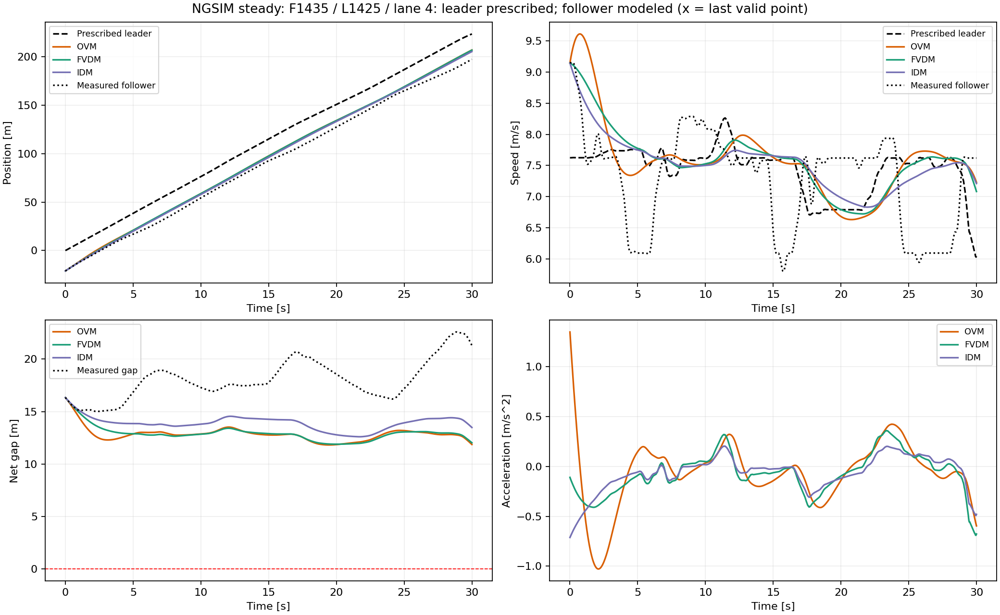
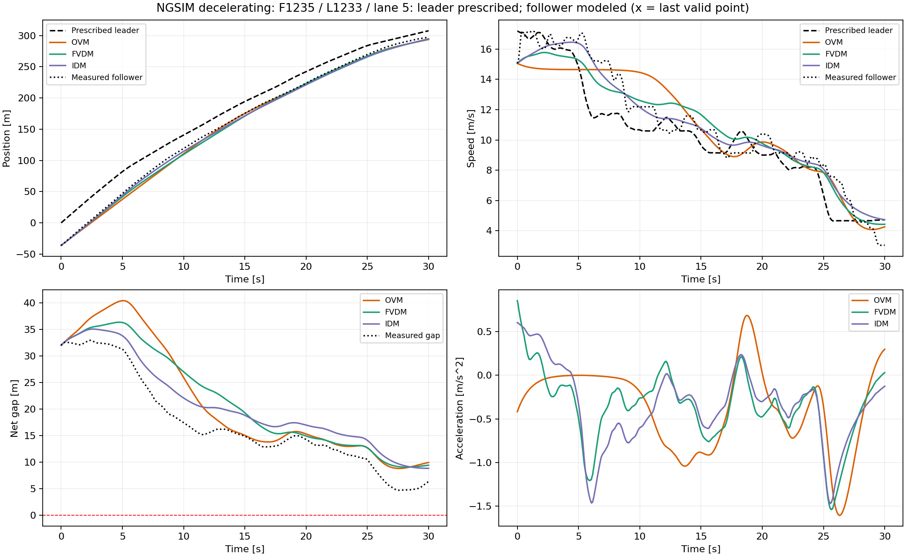
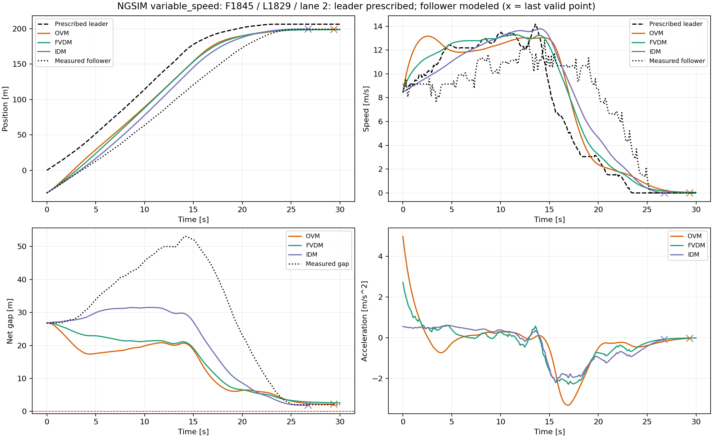

# 双车实验：NGSIM实测轨迹

按实测前车轨迹驱动OVM、FVDM、IDM，连续模拟后车，再与原始实测后车位置、速度及净间距比较。与人工前车轨迹实验并列。

从仓库根目录运行：

```powershell
python two_vehicle_experiments/ngsim/run_experiments.py
```

依赖NumPy、Matplotlib、Pandas。默认步长0.02 s；支持 `--dt`、`--output`、`--source`。

默认源文件：仓库外的 `../week04/data/NGSIM_I80_20050413_1600-1615_SI.csv`。路径由脚本自身位置定位；不复制、不修改源数据。

## 选样与输入

源CSV没有前车编号，先按每帧同车道纵向最近前方车辆推断前车，再筛选两者均为小汽车、车道1–5、关系连续30秒且无缺帧、净间距1–60 m且初始至少5 m的窗口。前后车均检查报告速度与位置导数的一致性；邻接关系在车型过滤前确定，避免跳过摩托车或卡车。

从有效窗口中分别按低速度波动、最大减速量和高速度波动选择三组不共享车辆的示例，不使用模型仿真结果挑选，也未对案例标定参数。车辆ID、原始时间范围和筛选数见结果报告。

前车位置做11点中心移动平均后进行单调Hermite插值，速度由位置解析求导；实测后车位置、速度不平滑，作为误差基准。前车处理偏差另列在JSON中。NGSIM的Local_Y为车头中心坐标，净间距扣除前车实际长度；源文件已是米、秒单位。[FHWA字段定义](https://ops.fhwa.dot.gov/publications/fhwahop08054/sect7.htm)。

## 看结果

- 本页直接展示对比图与三组实测案例轨迹，包含位置/速度RMSE、最小净间距与失败情况。
- [实验报告](results/实验报告.md)：样本信息、误差表、选样与处理说明。
- `results/NGSIM_*.png`：各案例的位置、速度、净间距、加速度。
- `results/metrics.json`：完整参数、源文件校验和、误差、响应平移时差、覆盖率和失败记录。
- `results/data/`：12份数组（3案例×实测片段和3模型）。
- `results/validation.json`：步长减半后的复核摘要。

提前失败时，三个模型的主要实测RMSE取共同有效时段，同时保留各自有效时段误差。模型参数未针对NGSIM标定，三个案例不代表普遍排名。图中×的含义和失败判据见 [双车实验总说明](../README.md)。

## 总体比较


## 平稳跟驰：后车1435，前车1425



## 明显减速：后车1235，前车1233



## 大幅变速：后车1845，前车1829



`results/data/*.npz` 为本地生成数组，已加入Git忽略规则；原始CSV也需在本地准备。图像和误差报告保留在仓库中，浏览结果无需下载数组。
