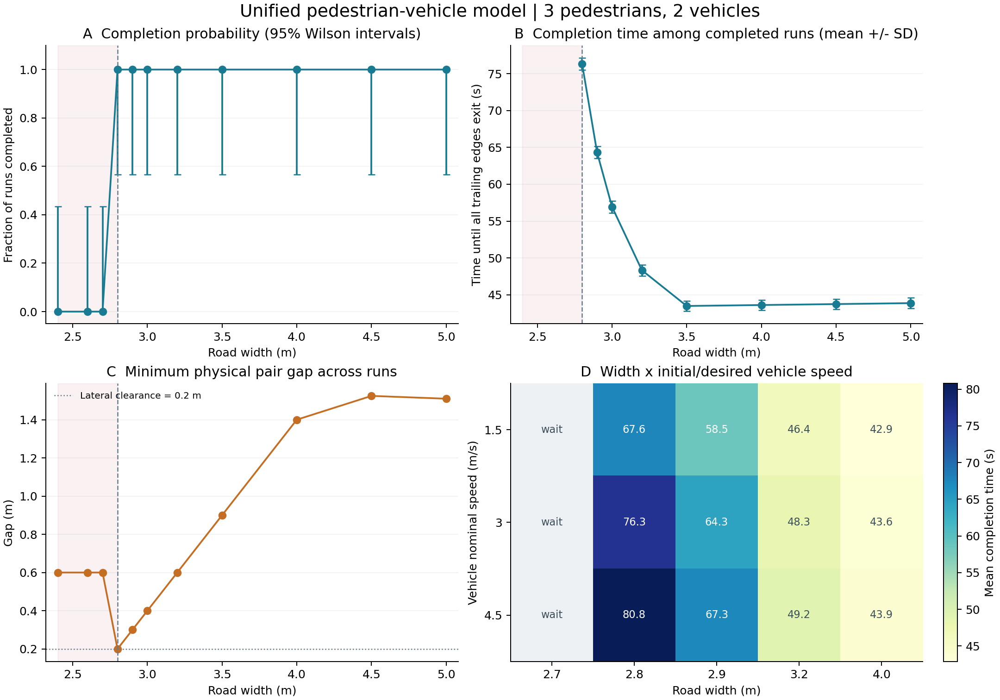
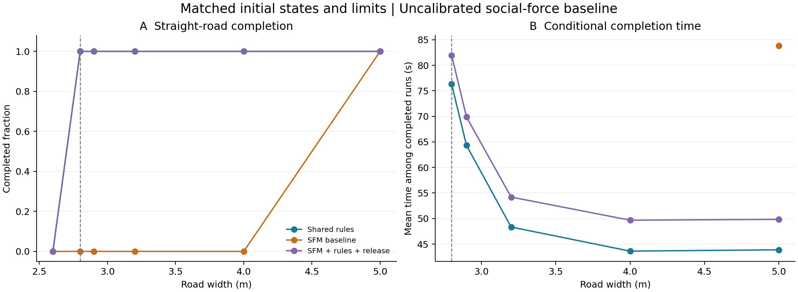

# 人车交互模型与实验报告

生成日期：2026-10-23。所有数值来自本目录保存的仿真输出；配置与原始结果可逐项复现。

## 1. 交付内容与主要发现

本包整理了 668 次已保存仿真：统一规则灵敏度 360 次、三模型配对对照 120 次、社会力参数探索 48 次、失败与修正 11 次、基础场景演示 9 次、向心穿越 120 次。演示和对照可能重复相同配置，不能将总数解释为相互独立样本。

- 人和车共享运动方程及交互实现，区别只体现在尺寸和运动能力参数；质量不直接分配避让责任。

- 默认车宽1.8 m、人宽0.6 m，几何下限为2.4 m；加入双方间距0.2 m和两侧各0.1 m后，安全断面下限为2.8 m。

- 默认3人2车、5个种子：5.0 m道路平均完成 43.88 s，3.2 m为 48.34 s，2.8 m为 76.30 s；2.6 m全部等待。

- 2.9 m道路即使总宽够，车辆固定居中仍会挡住通道；允许车辆以0.2 m/s上限小幅靠边后通过。

- 纯社会力基线在部分宽路能完成，但在窄路、多方向汇聚中出现碰撞/越界/僵持；逐步修正对照保留了未成功的中间方案。

- 圆环实验为人车交替排布、向中心穿越到对径点；默认4人4车形成僵持，单人单车规则模型可完成。

[模型方程与假设](MODEL.md) · [规则与指标定义](RULES.md) · [参数表](PARAMETERS.md) · [运行方法](../README.md)

[基础场景动画](../results/demo/replay.html) · [直路三模型动画](../results/benchmark/replay.html) · [向心动态主页](../index.html) · [失败修正动画](../results/failures/replay.html)

## 2. 基础设置与实验口径

直路长60 m，默认3人2车，车辆沿+s、行人沿−s。所有主体初始同一横向路径，车辆根据最窄宽度预先靠边。向心实验默认半径12 m、4人4车，观察120 s。步长0.05 s，每个正式配置种子0–4；随机性仅为速度基值的±8%扰动。

三模型使用同一初始状态和约束，不按类型调用不同积分器。纯SFM参数A=8 m/s²、B=1.5 m，软墙幅值3 m/s²、范围0.2 m。它是同包络适配的工程基线，未做实测标定；有限参数探索结果全部公开。

通过时间只对已完成直路运行求均值。失败、等待和超时用—表示，不补零。向心实验以对径目标到达数和全部完成率评价，不使用周期通量。

## 3. 道路宽度与数值灵敏度

| 宽度/m | 完成次数 | 平均完成/s | SD/s | 95% Wilson完成率区间 | 最小间距/m | 结果 |
| --- | --- | --- | --- | --- | --- | --- |
| 5 | 5/5 | 43.88 | 0.72 | [0.57, 1.00] | 1.510 | 全部通过 5 |
| 4.5 | 5/5 | 43.75 | 0.71 | [0.57, 1.00] | 1.525 | 全部通过 5 |
| 4 | 5/5 | 43.62 | 0.70 | [0.57, 1.00] | 1.400 | 全部通过 5 |
| 3.5 | 5/5 | 43.49 | 0.69 | [0.57, 1.00] | 0.900 | 全部通过 5 |
| 3.2 | 5/5 | 48.34 | 0.76 | [0.57, 1.00] | 0.600 | 全部通过 5 |
| 3 | 5/5 | 56.94 | 0.82 | [0.57, 1.00] | 0.400 | 全部通过 5 |
| 2.9 | 5/5 | 64.31 | 0.82 | [0.57, 1.00] | 0.300 | 全部通过 5 |
| 2.8 | 5/5 | 76.30 | 0.82 | [0.57, 1.00] | 0.200 | 全部通过 5 |
| 2.7 | 0/5 | — | — | [0.00, 0.43] | 0.600 | 安全间距不足等待 5 |
| 2.6 | 0/5 | — | — | [0.00, 0.43] | 0.600 | 安全间距不足等待 5 |
| 2.4 | 0/5 | — | — | [0.00, 0.43] | 0.600 | 安全间距不足等待 5 |



临界宽度附近变慢，部分来源于显式的窄路慢行系数；它是模型假设的作用，并非脱离假设发现的经验规律。安全下限以下的最小间距约0.6 m，是双方停在纵向间隔处，并不是已经实现横向通过。

统一规则全部灵敏度运行分类：全部通过 290次；安全间距不足等待 65次；固定位置阻塞 5次。

| 步长/s | 平均完成/s | SD/s | 完成率 |
| --- | --- | --- | --- |
| 0.1 | 64.44 | 0.85 | 100% |
| 0.05 | 64.31 | 0.82 | 100% |
| 0.025 | 64.23 | 0.83 | 100% |

[所有单因素、交互和圆环灵敏度表](SENSITIVITY.md) 包含尺寸、初始距离、人数、速度、横向能力、间距、质量负对照、步长、宽度×车速、向心初始半径与主体对数的结果。

## 4. 统一规则与社会力模型对照

| 直路宽度/m | 策略 | 完成率 | 满足裕度的完成率 | 条件平均完成/s | 碰撞运行 | 越界运行 | 结果 |
| --- | --- | --- | --- | --- | --- | --- | --- |
| 5 | 统一规则 | 100% | 100% | 43.88 | 0 | 0 | 全部通过 5 |
| 5 | 社会力基线 | 100% | 100% | 83.84 | 0 | 0 | 全部通过 5 |
| 5 | 社会力+完整修正 | 100% | 100% | 49.84 | 0 | 0 | 全部通过 5 |
| 4 | 统一规则 | 100% | 100% | 43.62 | 0 | 0 | 全部通过 5 |
| 4 | 社会力基线 | 0% | 0% | — | 0 | 5 | 越界 5 |
| 4 | 社会力+完整修正 | 100% | 100% | 49.68 | 0 | 0 | 全部通过 5 |
| 3.2 | 统一规则 | 100% | 100% | 48.34 | 0 | 0 | 全部通过 5 |
| 3.2 | 社会力基线 | 0% | 0% | — | 0 | 5 | 越界 5 |
| 3.2 | 社会力+完整修正 | 100% | 100% | 54.20 | 0 | 0 | 全部通过 5 |
| 2.9 | 统一规则 | 100% | 100% | 64.31 | 0 | 0 | 全部通过 5 |
| 2.9 | 社会力基线 | 0% | 0% | — | 0 | 5 | 越界 5 |
| 2.9 | 社会力+完整修正 | 100% | 100% | 69.87 | 0 | 0 | 全部通过 5 |
| 2.8 | 统一规则 | 100% | 100% | 76.30 | 0 | 0 | 全部通过 5 |
| 2.8 | 社会力基线 | 0% | 0% | — | 0 | 3 | 越界 3、策略僵持 2 |
| 2.8 | 社会力+完整修正 | 100% | 100% | 81.98 | 0 | 0 | 全部通过 5 |
| 2.6 | 统一规则 | 0% | 0% | — | 0 | 0 | 安全间距不足等待 5 |
| 2.6 | 社会力基线 | 0% | 0% | — | 0 | 1 | 安全间距不足等待 4、越界 1 |
| 2.6 | 社会力+完整修正 | 0% | 0% | — | 0 | 0 | 安全间距不足等待 5 |



这组比较支持的是具体实现、参数与初态下的差异。纯SFM软排斥不自动提供可行路线或硬安全边界，规则模型主动加入了选边、前瞻、慢行和制动约束，不能据此宣称所有社会力模型都较差。完成时间对失败样本不定义，不能只比较成功样本时间而忽略失败率。

## 5. 圆环向心穿越

人车交替均布于圆周，同时向中心移动，目标为各自对径点。详见[向心模型、适配与120次结果](CIRCLE.md)，[动态主页](../index.html)。

| 配置 | 策略 | 全部到达率 | 条件完成/s | 平均到达数 | 碰撞运行 | 结果 |
| --- | --- | --- | --- | --- | --- | --- |
| baseline | 统一规则 | 0% | — | 0.0 | 0 | 策略僵持 5 |
| baseline | 社会力基线 | 0% | — | 0.0 | 0 | 策略僵持 5 |
| baseline | 社会力+完整修正 | 0% | — | 0.0 | 0 | 策略僵持 5 |
| mobile | 统一规则 | 0% | — | 0.0 | 0 | 策略僵持 5 |
| mobile | 社会力基线 | 0% | — | 0.0 | 0 | 策略僵持 5 |
| mobile | 社会力+完整修正 | 0% | — | 0.0 | 0 | 策略僵持 5 |
| one_pair | 统一规则 | 100% | 21.98 | 2.0 | 0 | 全部通过 5 |
| one_pair | 社会力基线 | 0% | — | 0.0 | 0 | 策略僵持 5 |
| one_pair | 社会力+完整修正 | 100% | 21.98 | 2.0 | 0 | 全部通过 5 |
| two_pairs | 统一规则 | 0% | — | 0.0 | 0 | 策略僵持 5 |
| two_pairs | 社会力基线 | 0% | — | 0.0 | 5 | 碰撞 5 |
| two_pairs | 社会力+完整修正 | 0% | — | 0.0 | 0 | 策略僵持 5 |
| dense | 统一规则 | 0% | — | 0.0 | 0 | 策略僵持 5 |
| dense | 社会力基线 | 0% | — | 0.0 | 0 | 策略僵持 5 |
| dense | 社会力+完整修正 | 0% | — | 0.0 | 0 | 策略僵持 5 |
| radius_8 | 统一规则 | 0% | — | 0.0 | 0 | 策略僵持 5 |
| radius_8 | 社会力基线 | 0% | — | 0.0 | 0 | 策略僵持 5 |
| radius_8 | 社会力+完整修正 | 0% | — | 0.0 | 0 | 策略僵持 5 |
| radius_16 | 统一规则 | 0% | — | 0.0 | 0 | 策略僵持 5 |
| radius_16 | 社会力基线 | 0% | — | 0.0 | 0 | 策略僵持 5 |
| radius_16 | 社会力+完整修正 | 0% | — | 0.0 | 0 | 策略僵持 5 |
| slow_vehicle | 统一规则 | 0% | — | 0.0 | 0 | 策略僵持 5 |
| slow_vehicle | 社会力基线 | 0% | — | 0.0 | 0 | 策略僵持 5 |
| slow_vehicle | 社会力+完整修正 | 0% | — | 0.0 | 0 | 策略僵持 5 |

默认4人4车在现有局部规则下僵持；允许车辆0.2 m/s侧移仍未解除。规则与修正版在单人单车中均5/5完成；纯SFM在2人2车中均碰撞。不同朝向投影矩形较保守，等待不能证明真实场景无路可走。

## 6. 失败案例、原因与修正对照

| 案例 | 策略 | 终局 | 完成/s | 互过次数 | 碰撞对数 | 越界主体数 |
| --- | --- | --- | --- | --- | --- | --- |
| 空间不足：2.6 m 等待 | 统一规则 | 安全间距不足等待 | — | 0 | 0 | 0 |
| 扩大宽度：2.8 m 通过 | 统一规则 | 全部通过 | 76.82 | 6 | 0 | 0 |
| 车居中：2.9 m 阻塞 | 统一规则 | 固定位置阻塞 | — | 0 | 0 | 0 |
| 允许车侧移：2.9 m 通过 | 统一规则 | 全部通过 | 64.36 | 6 | 0 | 0 |
| 制动距离不足：初速 12 m/s | 统一规则 | 碰撞 | — | 0 | 1 | 0 |
| 只降低初始/期望车速：1.5 m/s | 统一规则 | 全部通过 | 35.45 | 1 | 0 | 0 |
| SFM：短作用距离导致风险 | 社会力基线 | 碰撞 | — | 0 | 1 | 0 |
| SFM：扩大作用范围，5 m 通过 | 社会力基线 | 全部通过 | 80.21 | 6 | 0 | 0 |
| SFM：3.2 m 窄路软边界不足 | 社会力基线 | 越界 | — | 0 | 0 | 1 |
| 部分修正：选边与制动，仍可能僵持 | 社会力+部分修正 | 策略僵持 | — | 3 | 0 | 0 |
| 完整修正：解除已消除的冲突力 | 社会力+完整修正 | 全部通过 | 54.12 | 6 | 0 | 0 |

- 空间不足：2.6 m无法同时保留所设安全裕度。改为2.8 m后通过；没有通过压缩实体或取消碰撞检查来伪造修正。

- 固定车道阻塞：2.9 m车居中时单侧空间不够；只开放车辆小幅侧移能力后通过。

- 制动距离不足：初始中心距5 m、车速12 m/s时发生碰撞；保持位置及其他条件，只将初始/期望车速降为1.5 m/s后通过。它说明控制器无法补救任意危险初态。

- 社会力作用过短：A=4、B=0.8的5 m场景发生碰撞；A=8、B=1.5在该宽路配置通过。但增加排斥范围并不能解决所有窄路问题。

- 软边界不足：相同SFM参数在3.2 m发生越界。加入明确横向目标和制动后虽避免此失败，保留已分离主体的排斥仍可造成后续僵持。

- 中间修正失败：sfm_guided_ungated互过3次后僵持；在已经横向分离的相向主体间解除SFM排斥，完整修正版完成6次互过并全部退出。向心实验另列为多方向汇聚对照。

这些解释对应保存的案例，不应泛化为所有新场景的充分因果证明。断面诊断是必要条件分析，几何上能放下不意味着局部策略一定可达。

## 7. 社会力参数探索

探索场景为3.2 m、1人1车、种子100–102。默认A=8、B=1.5参考了探索结果；未使用实测数据，也未声称对所有路宽、密度和软墙参数完成调优。

[参数探索原始表](../results/sfm_parameters/sfm_parameters.csv)

## 8. 验证与复现

自动测试覆盖类型/质量不变性、同步顺序不变性、加减速限制、几何临界值、固定车道对照、缩窄路、连续步内穿越碰撞、固定朝向矩形交叉接触、整体旋转不变性、向心终点停车、SFM失败和混合模型修正。完整输出见 [验证日志](../results/validation.txt)。

核心仿真仅依赖Python标准库。统计图可导出PNG和SVG，回放不依赖网络。每次运行的JSON记录完整参数、初态和指标；CSV提供统计及轨迹。

```powershell

python -m unittest discover -s tests -v

python -m pvsim all --seeds 5 --plots --out results

python -m pvsim.report --root .

```

## 9. 仍需验证的内容

- 使用实际人车轨迹标定期望速度、反应/感知延迟、距离感知、个体差异和软墙参数。

- 真正车辆转向与刚体弯道：当前小幅侧移是受限二维速度模型，向心主体保持初始朝向，尚无自行车模型或转向角约束。

- 局部等待与全局可达性：当前只检测全体停滞；可加入等待图、退让、交替放行、避车港和全局路径规划。

- 更多重复与不确定性来源：每配置5次仅覆盖有限的速度扰动；Wilson区间很宽，不能把5/5等同真实世界可靠率100%。

- 初始速度扫描同时改变期望速度，初始距离扫描也改变剩余路程。原始表保留这些设计，不能把完成时间差全部归因于碰撞规避效率。

## 10. 参考资料

- [Helbing & Molnár：Social Force Model for Pedestrian Dynamics](https://arxiv.org/abs/cond-mat/9805244)

- [Yang et al.：人车多状态社会力交互框架](https://arxiv.org/abs/2005.07769)

- [ORCA：互惠避碰相关路线；本代码并未实现ORCA](https://gamma.cs.unc.edu/ORCA/)